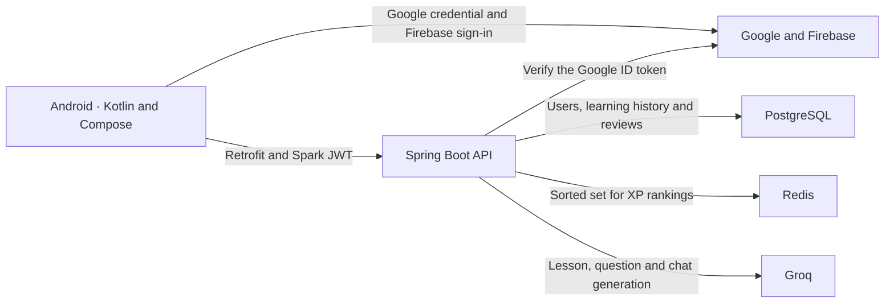

# How Spark works

Spark uses a Kotlin and Jetpack Compose Android app, a Java 21 and Spring Boot 3.3.5 backend, PostgreSQL, and Redis. The backend is one application. Its controllers handle HTTP, services handle the app logic, and repositories handle persistence.

## Interruption and learning

`SparkInterceptorService` observes the foreground app using Android UsageStats and opens `SparkOverlayActivity` for a monitored app. The overlay uses an available prefetched AI lesson or shows bundled content immediately. It prefetches for a future interruption. Choosing **Explore this idea** records an eligible lesson and opens the reader. The reader uses the main Android window and places the completion control above the navigation area.

`SparkAIClient` sends AI requests to the backend. `GroqAIService` uses `openai/gpt-oss-120b`, parses the result, and checks the content with `AIContentValidator`. The rules check structure, length, duplicates and some unsafe phrasing. They do not prove factual accuracy. Bundled suggestions and lessons give selected screens a local fallback. A failed answer to a selected AI question keeps that question and reports an error.

## Accounts and storage

The Android app signs into Firebase and sends the original Google ID token to `POST /api/v1/auth/google`. The backend verifies it and issues a Spark JWT. Android stores the session in DataStore and attaches the JWT to protected requests. The backend takes account identity from the verified JWT.

PostgreSQL stores users, XP, completed lessons, flashcards and review attempts. Android keeps account-scoped local settings and progress. Completed lesson history rebuilds the Mind Palace presentation. The graph and cognitive labels are app presentation features. Account deletion removes the backend account and its dependent data and clears the selected account's local state.

## Assessment and leaderboard

Knowledge Check uses five distinct, synchronized lesson records marked as explicitly explored during interceptions. The backend asks Groq for one question per source, validates the questions, and stores the attempt with the correct answers. Android gets the options. The backend scores the submitted answers and saves a dated result. This quiz score is separate from XP, streak and flashcard scheduling.

The backend rebuilds the Redis ranking set from PostgreSQL XP when the leaderboard is requested. The app loads the board on the first Profile visit in a login session and caches it until **Refresh** or account change. Profile edits save the chosen display name to PostgreSQL. Google sign-in preserves it, and other users see the updated name after refreshing.

## API map

| Feature | Routes |
|---|---|
| Google sign-in | `POST /api/v1/auth/google` |
| Progress and profile name | `GET /api/v1/user/progress`, `POST /api/v1/user/progress` |
| Leaderboard | `GET /api/v1/user/leaderboard` |
| Account deletion | `DELETE /api/v1/user/delete` |
| AI | `POST /api/v1/spark`, `POST /api/v1/spark/questions`, `POST /api/v1/spark/wormhole` |
| Knowledge Check | `POST /api/v1/reviews/start`, `POST /api/v1/reviews/{id}/submit`, `GET /api/v1/reviews/history` |
| Additional backend routes | `POST /api/v1/user/redeem`, `GET /api/v1/flashcards`, `POST /api/v1/flashcards`, `PATCH /api/v1/flashcards/{id}`, `POST /api/v1/stripe/webhook` |

The Stripe route verifies signed webhook requests. The Android app does not offer a complete Stripe checkout or a flashcard review screen backed by these routes.
