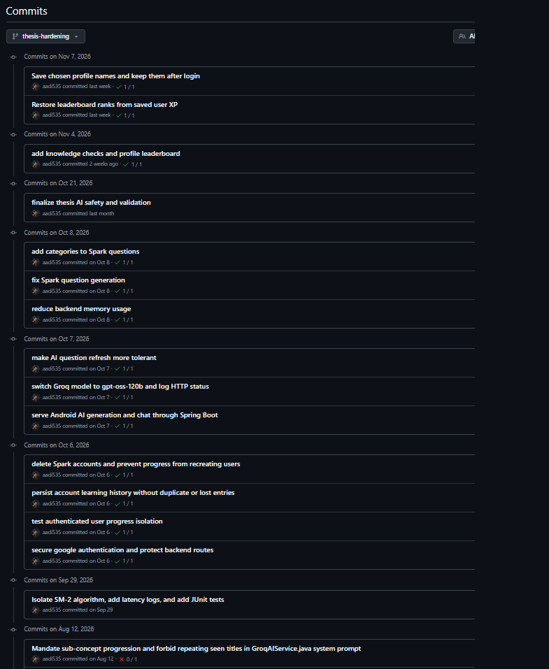
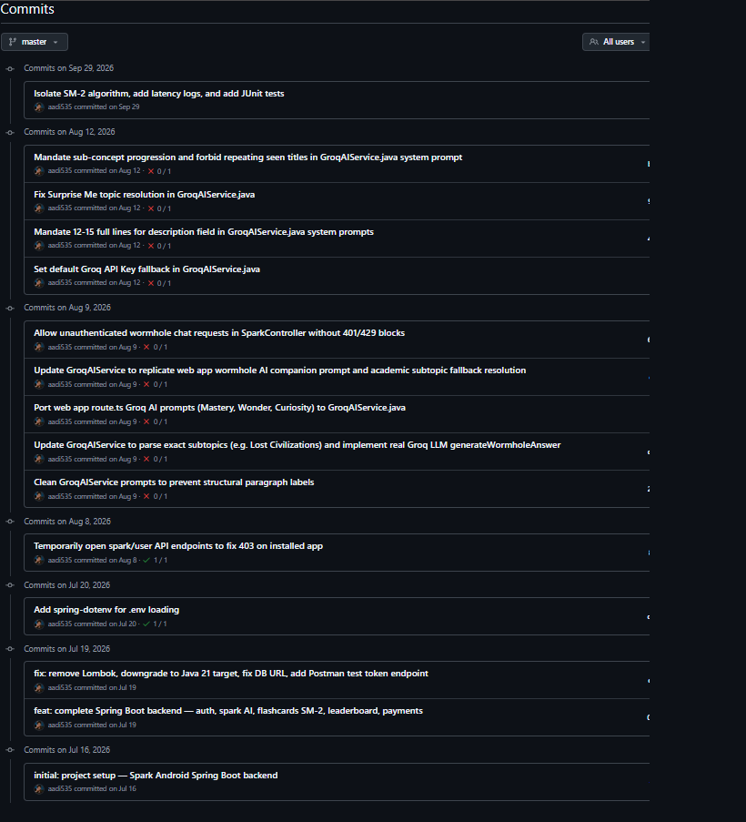
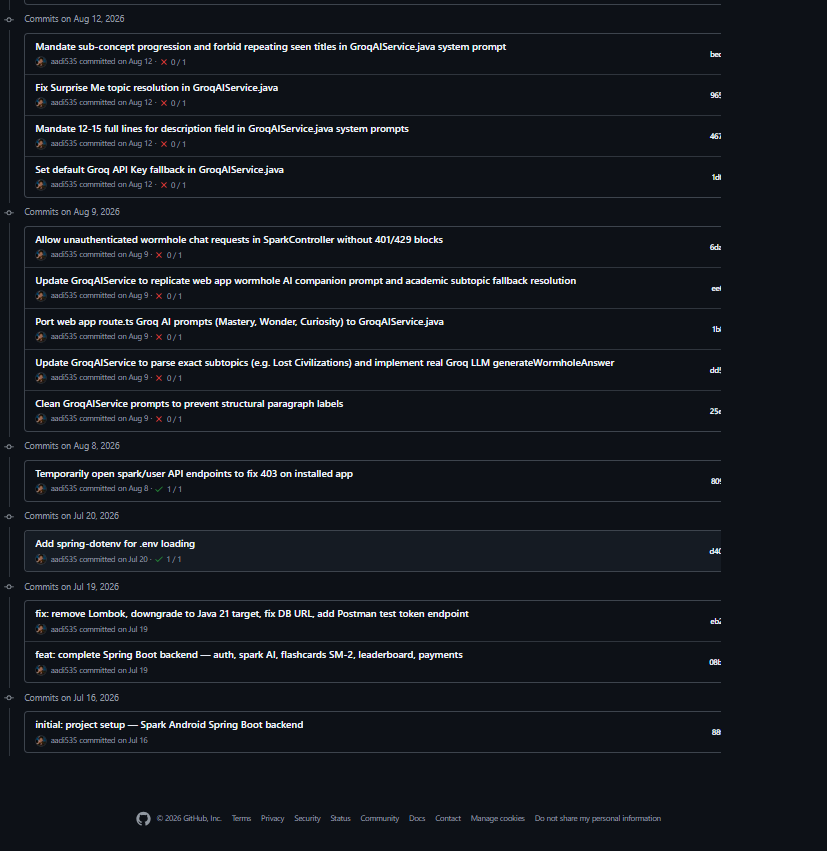
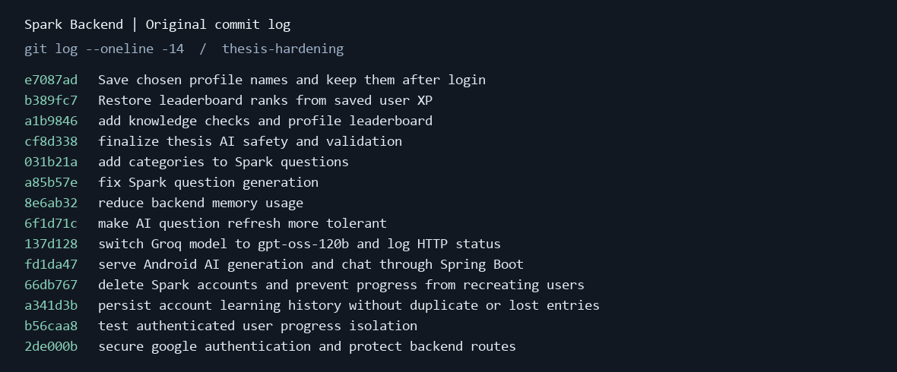

# Development history

These entries come from the original private Spark backend repository. The original repository remains private because older revisions contain credentials and development configuration that should stay out of the public review copy. These screenshots from GitHub show the development chronology and contributor account. The right edge has been covered to hide private commit references. Earlier entries document experiments during development.

## GitHub screenshots

### Thesis hardening

Thesis branch through November 7, including Knowledge Check, leaderboard recovery and display-name persistence.



### Early development

Early backend work from July through September, including initial setup, AI integration and flashcard scheduling.



### Initial setup

A closer view of the earliest backend commits and experiments. Some entries overlap the previous screenshot.



## Snapshot commit log



```text
e7087ad Save chosen profile names and keep them after login
b389fc7 Restore leaderboard ranks from saved user XP
a1b9846 add knowledge checks and profile leaderboard
cf8d338 finalize thesis AI safety and validation
031b21a add categories to Spark questions
a85b57e fix Spark question generation
8e6ab32 reduce backend memory usage
6f1d71c make AI question refresh more tolerant
137d128 switch Groq model to gpt-oss-120b and log HTTP status
fd1da47 serve Android AI generation and chat through Spring Boot
66db767 delete Spark accounts and prevent progress from recreating users
a341d3b persist account learning history without duplicate or lost entries
b56caa8 test authenticated user progress isolation
2de000b secure google authentication and protect backend routes
```
